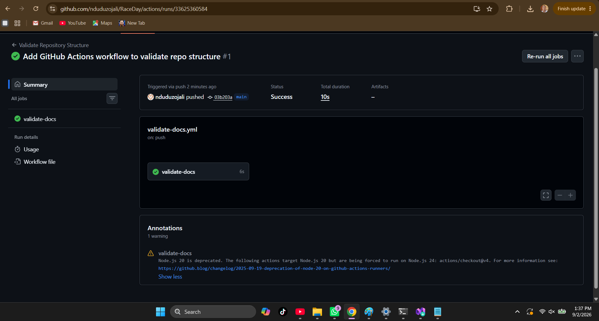
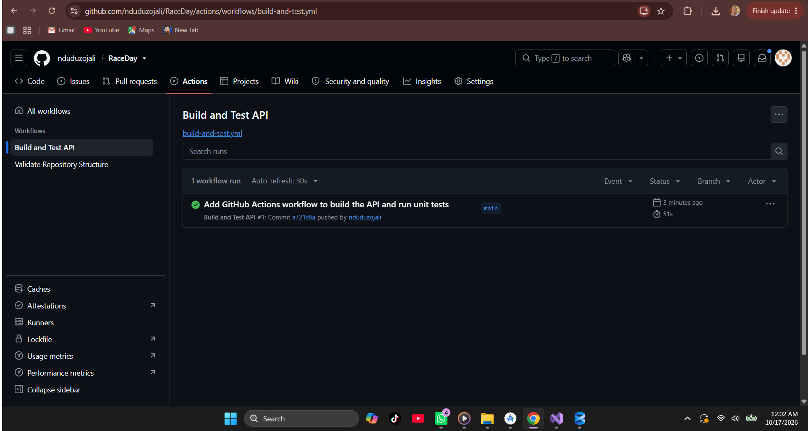

# RaceDay

## Description
RaceDay is a full-stack web-based event management system designed for the South African road running, walking, and cycling community. The platform allows Event Organisers to create and manage events, categories, and participant results, while Participants can browse events, enter events, and track their personal performance history.

This repository currently contains **Part 1: System Planning and Database** — the ERD, API endpoint plan, and SQL database script for the system.

## Roles
The system supports two distinct user roles:

- **Organiser** – can create, edit, and delete events, manage event categories, capture participant results, and view all event enrolments.
- **Participant** – can create an account, browse events, enter an event by selecting a category, view their own enrolments, and track their personal results.

## Repository Structure
```
/docs
  ├── ERD.pdf              # Entity Relationship Diagram
  ├── EndpointPlan.md      # API endpoint specification table
  └── RaceDay_Schema.sql   # SQL Server database creation + seed script
```

## Database Script
The SQL script in `/docs/RaceDay_Schema.sql` creates all 6 entities (User, Event, Category, Enrolment, Result, Payment) with primary keys, foreign keys, and constraints, and seeds the database with sample data (2 Organisers, 2 Participants, 3 Events, categories, and enrolments). It has been tested to run without errors on a clean SQL Server instance in SSMS.

## CI/CD
A GitHub Actions workflow validates that the `/docs` folder exists and contains the required files on every push.

**Build status screenshot:**



## Video Walkthrough
[Watch Part 1 Walkthrough](https://youtube.com/shorts/yLK2ZqR84qA?si=eVCc81xRQl7mmzBF)

## AI Tool Disclosure
AI tools were used during the planning process to assist with structuring the ERD, endpoint plan, and SQL script, as well as troubleshooting Git/GitHub setup steps. All planning decisions and final content were reviewed and understood by the author.


# Part 2 - RaceDay RESTful API

The Part 2 code is in the `RaceDay.Api` folder (API) and `RaceDay.Api.Tests` (unit tests) of this repository, on the `main` branch.

## Setup and Run Instructions

**Requirements:** .NET SDK, Visual Studio, SQL Server Express (`.\SQLEXPRESS`)

1. Clone the repository and open the solution in Visual Studio.
2. Check the connection string in `RaceDay.Api/appsettings.json`:
   `Server=.\SQLEXPRESS;Database=RaceDayApiDB;Trusted_Connection=True;TrustServerCertificate=True;`
3. Create the database (Entity Framework Core, code-first), from the solution folder:
   `dotnet ef database update --project RaceDay.Api`
4. Run the API:
   `cd RaceDay.Api`
   `dotnet run --launch-profile https`
5. Open Swagger in the browser: `https://localhost:7266/swagger`
6. Run the unit tests from the solution folder: `dotnet test`


## User Roles

**Organiser**
- Creates, updates and deletes events
- Defines categories for each event
- Views all enrolments for their events
- Captures finish times and finishing positions
- Views and updates their own profile

**Participant**
- Views events and categories
- Enrols in an event by selecting a category
- Views their own results
- Views and updates their own profile

Organiser endpoints return **403 Forbidden** for a Participant, and Participant endpoints return **403 Forbidden** for an Organiser. Requests with no token return **401 Unauthorized**.

**How roles are managed:** anyone can register as a Participant. To register as an Organiser, the user must supply the organiser registration code (`OrganiserRegistrationCode` in `appsettings.json`). This stops people from simply choosing the Organiser role.


## Authentication and Session Management

Users register with their details and a role, then log in with their credentials. Passwords are hashed before they are stored, and the original password is never saved.

After login, the API issues a signed token (JWT) containing the user's ID and role. The client sends this token with every request, which is how the user's authenticated state and role are maintained across requests. Non-public endpoints are only accessible to authenticated users, and the role in the token decides which endpoints they can use.

To test in Swagger: log in, copy the token, click **Authorize**, and paste it in.


## CI/CD



## Part 2 Video

https://youtu.be/YOUR-LINK-HERE

